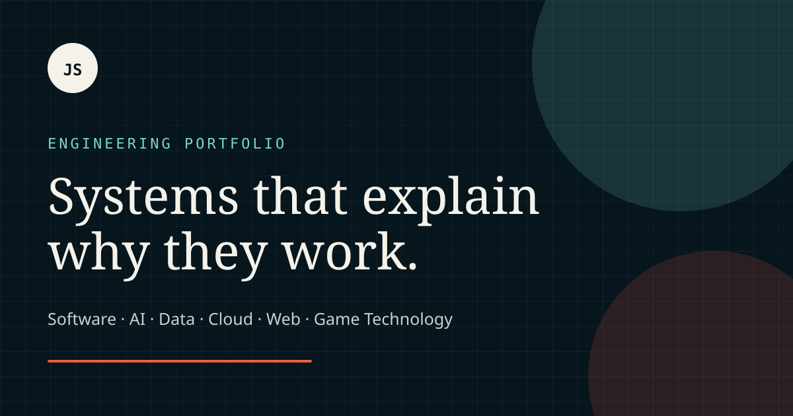

# Portfolio Case Study Site

[](https://github.com/JasonStys/portfolio-case-study-site/actions/workflows/ci.yml)
[](https://github.com/JasonStys/portfolio-case-study-site/actions/workflows/codeql.yml)

An evidence-first engineering portfolio that helps employers evaluate the design judgment behind the code—not just scan a repository list.

**Live site:** [jasonstys.github.io/portfolio-case-study-site](https://jasonstys.github.io/portfolio-case-study-site/)



## Why this exists

A broad GitHub profile can make strong work harder to evaluate. This site creates one consistent navigation layer across software engineering, full-stack systems, AI/ML, analytics, cloud infrastructure, cybersecurity, DevOps, accessible web development, firmware, and game technology.

Six featured projects use the same employer-friendly narrative:

> problem → constraints → design → verification → measured result → limitations

The complete **60-repository catalog** remains searchable by role, language, domain, maturity, and free text. Six broad featured cases lead; nine reference cases include four new space-systems studies. The [space & energy collection](https://jasonstys.github.io/portfolio-case-study-site/space-systems/) includes all **14 completed space-related projects**.

## Space & energy systems: where to start

These are civilian educational projects relevant to space-sector, government and contractor engineering interests—not claims of military employment, clearance, flight qualification or agency endorsement. The existing six broad portfolio highlights remain unchanged; the new collection gives specialist reviewers a direct reading path.

| Highlight                 | What to inspect                                                                                   | Source / detailed case                                                                                                                                                                                 |
| ------------------------- | ------------------------------------------------------------------------------------------------- | ------------------------------------------------------------------------------------------------------------------------------------------------------------------------------------------------------ |
| Flight-software recovery  | C++ executive, watchdog deadlines, checkpoint decoding, independent replay and sanitizers         | [Repository](https://github.com/JasonStys/spacecraft-flight-software-testbed) · [Case study](https://jasonstys.github.io/portfolio-case-study-site/case-studies/spacecraft-flight-software-testbed/)   |
| Explainable telemetry     | Frozen training, causal scoring, held-out comparison, false alarms and missing data               | [Repository](https://github.com/JasonStys/spacecraft-telemetry-anomaly-studio) · [Case study](https://jasonstys.github.io/portfolio-case-study-site/case-studies/spacecraft-telemetry-anomaly-studio/) |
| Exact resource allocation | Branch-and-bound, explicit constraints, greedy comparison and independent exhaustive oracle       | [Repository](https://github.com/JasonStys/mission-contact-resource-scheduler) · [Case study](https://jasonstys.github.io/portfolio-case-study-site/case-studies/mission-contact-resource-scheduler/)   |
| Verification evidence     | Revision bindings, newest-attempt rules, fault coverage, actual JUnit adapter and SQL cross-check | [Repository](https://github.com/JasonStys/mission-verification-evidence-kit) · [Case study](https://jasonstys.github.io/portfolio-case-study-site/case-studies/mission-verification-evidence-kit/)     |

The [complete collection](https://jasonstys.github.io/portfolio-case-study-site/space-systems/) also includes spacecraft power/thermal modeling, orbital safety, CCSDS parsing, delay-tolerant networking, Earth observation, clock integrity, microgrid resilience, sensor calibration, space weather and reactor-system education. All 14 are individually listed in the ordered summary below and searchable with the **Space systems** domain facet. Selection reflects integration depth, independent checks and clear failure evidence—not stars or an arbitrary seniority score.

Most scenarios are synthetic; attributed public Sentinel-2 observations and frozen NOAA weather records are distinguished in their repositories. No operational targeting, live reactor connection or real mission control is supplied. Release downloads are unsigned platform-specific desktop apps; hashes are not publisher signatures. Follow each repository's limitations and OS security policies.

## Ordered portfolio

Business Knowledge Workbench's **v1.2.0** case now emphasizes its primary purpose:
standardizing supported documents and data into consistent units, field structure,
document layout, and output types through owner-controlled standards. Its draft
preview, revision history/restoration, preserved originals, and current-standard
copies demonstrate governance as well as conversion. See the [updated case study](https://jasonstys.github.io/portfolio-case-study-site/case-studies/business-knowledge-workbench/)
and [published release](https://github.com/JasonStys/business-knowledge-workbench/releases/tag/v1.2.0).
It remains the #2 featured project; its private edition is local and owner-only,
not a hosted shared-team service or a universal OCR engine.

Created by [Jason Stys](https://github.com/JasonStys) · [Professional contact](https://www.linkedin.com/in/jason-stys-31b30b351/).

This is a reviewed presentation order, not a numeric skill rating. Broad integrated systems lead, followed by specialized systems and defensive assurance labs. Integration depth, reproducible evidence, and role breadth matter more than repository size or popularity. Lower placement does not mean lower quality. The portfolio hub is linked prominently above but is last here because it organizes the engineering work.

GitHub supports six ordered profile pins, but not a custom ordering of every repository in its Repositories tab. The first six below are the selected profile pins and starred highlights; this README and [project catalog](https://jasonstys.github.io/portfolio-case-study-site/projects/) provide the complete curated order. Search filtering preserves that order.

| Order | Repository                                                                                                | Demonstrated outcome                                                                                                                                            |
| ----- | --------------------------------------------------------------------------------------------------------- | --------------------------------------------------------------------------------------------------------------------------------------------------------------- |
| 1     | [code-flow-studio](https://github.com/JasonStys/code-flow-studio)                                         | Connects a polyglot editor, isolated compiler workers, bounded fuzzing, revision evidence, and private local accounts.                                          |
| 2     | [business-knowledge-workbench](https://github.com/JasonStys/business-knowledge-workbench)                 | Standardizes business documents and data with owner-controlled units, field schemas, layouts, export types, and revision history in encrypted local workspaces. |
| 3     | [personal-image-model-studio](https://github.com/JasonStys/personal-image-model-studio)                   | Trains a real caption-conditioned image model with held-out evaluation, rights-aware datasets, and encrypted local accounts.                                    |
| 4     | [forge2d-engine](https://github.com/JasonStys/forge2d-engine)                                             | Combines a sparse-set ECS, deterministic replays, A*, collision broadphase, fuzzing, and SDL3.                                                                  |
| 5     | [secure-delivery-pipeline-lab](https://github.com/JasonStys/secure-delivery-pipeline-lab)                 | Verifies signed build identity, SBOMs, tamper resistance, staged promotion, and independently authenticated rollback.                                           |
| 6     | [applicant-evidence-studio](https://github.com/JasonStys/applicant-evidence-studio)                       | Links job-relevant skills to source evidence, preserves education uncertainty, and offers factual resume coaching without automated hiring.                     |
| 7     | [spacecraft-flight-software-testbed](https://github.com/JasonStys/spacecraft-flight-software-testbed)     | Exercises a deterministic C++ executive, watchdog deadlines, validated checkpoints and fault recovery against nominal replay.                                   |
| 8     | [spacecraft-telemetry-anomaly-studio](https://github.com/JasonStys/spacecraft-telemetry-anomaly-studio)   | Compares frozen context-aware telemetry limits with a pooled baseline using causal scoring, held-out evaluation and explicit missing data.                      |
| 9     | [mission-contact-resource-scheduler](https://github.com/JasonStys/mission-contact-resource-scheduler)     | Solves bounded contact allocation with exact branch-and-bound, a greedy comparison, resource ledgers and an independent exhaustive oracle.                      |
| 10    | [spacecraft-power-thermal-lab](https://github.com/JasonStys/spacecraft-power-thermal-lab)                 | Checks C++ power allocation and RK4 thermal integration against an independent Python model and separate energy ledgers.                                        |
| 11    | [mission-verification-evidence-kit](https://github.com/JasonStys/mission-verification-evidence-kit)       | Links requirements, tests, fault scenarios and release metadata with latest-attempt rules, stale-evidence checks and independent SQL verdicts.                  |
| 12    | [orbital-safety-workbench](https://github.com/JasonStys/orbital-safety-workbench)                         | Explores civilian orbital propagation and close-approach screening with reproducible evidence and explicit model limits—not targeting or guidance.              |
| 13    | [ccsds-telemetry-integrity-lab](https://github.com/JasonStys/ccsds-telemetry-integrity-lab)               | Differentially checks a bounded Rust telemetry-packet parser against Python while distinguishing gaps, reordering and unauthenticated payloads.                 |
| 14    | [delay-tolerant-mission-network-lab](https://github.com/JasonStys/delay-tolerant-mission-network-lab)     | Replays intermittent-contact queues, expiry, backpressure and a real Rust-worker restart with independent Python event verification.                            |
| 15    | [earth-observation-change-studio](https://github.com/JasonStys/earth-observation-change-studio)           | Reviews public Sentinel-2 dates with quality masks, aligned spectral differences, independently checked classifications and GeoTIFF/GeoJSON exports.            |
| 16    | [mission-clock-integrity-lab](https://github.com/JasonStys/mission-clock-integrity-lab)                   | Cross-checks integer-nanosecond clock simulation and interval-order audits across C++, Rust and Python without changing the host clock.                         |
| 17    | [resilient-energy-microgrid-lab](https://github.com/JasonStys/resilient-energy-microgrid-lab)             | Compares two synthetic research-station dispatch policies with exact-rational energy accounting, outage scenarios and explicit unmet demand.                    |
| 18    | [scientific-sensor-calibration-lab](https://github.com/JasonStys/scientific-sensor-calibration-lab)       | Checks a C# weighted calibration fit against exact-rational Python, propagates uncertainty and evaluates separate check observations.                           |
| 19    | [space-weather-impact-observatory](https://github.com/JasonStys/space-weather-impact-observatory)         | Preserves frozen NOAA Kp provenance and missing bins, enforces forecast eligibility and separates descriptive associations from causal claims.                  |
| 20    | [reactor-systems-simulator](https://github.com/JasonStys/reactor-systems-simulator)                       | Explores bounded educational reactor-system dynamics with documented assumptions, scenario comparisons and explicit non-operational limits.                     |
| 21    | [cloud-job-orchestrator](https://github.com/JasonStys/cloud-job-orchestrator)                             | Builds a safe DAG control plane with leases, observability, Kubernetes, and Terraform.                                                                          |
| 22    | [integration-operations-console](https://github.com/JasonStys/integration-operations-console)             | Makes retries, rate limits, audit trails, and dead-letter recovery inspectable end to end.                                                                      |
| 23    | [ml-model-lifecycle-observatory](https://github.com/JasonStys/ml-model-lifecycle-observatory)             | Demonstrates promotion gates, drift detection, canary routing, monitoring, and rollback.                                                                        |
| 24    | [player-telemetry-analytics-platform](https://github.com/JasonStys/player-telemetry-analytics-platform)   | Turns synthetic player events into tested funnels, cohorts, timelines, and anomaly reviews.                                                                     |
| 25    | [industrial-edge-digital-twin](https://github.com/JasonStys/industrial-edge-digital-twin)                 | Pairs a deterministic C++ process twin with typed edge APIs, MQTT telemetry, faults, and an HMI.                                                                |
| 26    | [accessible-design-system-lab](https://github.com/JasonStys/accessible-design-system-lab)                 | Packages native-first React components with Storybook, accessibility evidence, and bundle budgets.                                                              |
| 27    | [edge-vision-deployment-benchmark](https://github.com/JasonStys/edge-vision-deployment-benchmark)         | Compares reproducible ONNX inference across Python, C++, and Rust with quantization analysis.                                                                   |
| 28    | [secure-service-desk](https://github.com/JasonStys/secure-service-desk)                                   | Models multi-tenant support workflows with an outbox, signed webhooks, and auditable state.                                                                     |
| 29    | [offline-first-field-app](https://github.com/JasonStys/offline-first-field-app)                           | Demonstrates transactional SQLite sync, conflict handling, and a compatible ASP.NET Core API.                                                                   |
| 30    | [mips-pipeline-workbench](https://github.com/JasonStys/mips-pipeline-workbench)                           | Connects assembly, emulation, a five-stage pipeline, cache behavior, and an accessible trace UI.                                                                |
| 31    | [firmware-release-recovery-lab](https://github.com/JasonStys/firmware-release-recovery-lab)               | Simulates signed A/B updates, bounded trial boots, rollback, and power-loss recovery.                                                                           |
| 32    | [ot-security-monitor-lab](https://github.com/JasonStys/ot-security-monitor-lab)                           | Analyzes bounded Modbus captures against asset baselines and scoped maintenance windows without contacting industrial devices.                                  |
| 33    | [industrial-memory-protocol-workbench](https://github.com/JasonStys/industrial-memory-protocol-workbench) | Exercises defensive binary parsing with packet traces, fault injection, fuzzing, and sanitizers.                                                                |
| 34    | [detection-engineering-lab](https://github.com/JasonStys/detection-engineering-lab)                       | Evaluates synthetic endpoint and cloud events with explainable rules, correlation windows, and false-positive evidence.                                         |
| 35    | [sre-observability-workbench](https://github.com/JasonStys/sre-observability-workbench)                   | Traces real service calls through telemetry and exact SLO burn-rate checks with finite fault and recovery scenarios.                                            |
| 36    | [gitops-platform-lab](https://github.com/JasonStys/gitops-platform-lab)                                   | Tests declarative platform reconciliation, promotion policies, drift handling, and recovery in an isolated cluster lab.                                         |
| 37    | [container-runtime-security-lab](https://github.com/JasonStys/container-runtime-security-lab)             | Combines Falco replay checks with live isolated container probes and privacy-preserving runtime evidence.                                                       |
| 38    | [zero-trust-segmentation-lab](https://github.com/JasonStys/zero-trust-segmentation-lab)                   | Checks admission boundaries and real Linux IPv4 TCP segmentation with synthetic identities and explicit trust limits.                                           |
| 39    | [application-security-regression-lab](https://github.com/JasonStys/application-security-regression-lab)   | Exercises four native services with authorization, session isolation, negative HTTP cases, and concurrency regressions.                                         |
| 40    | [cloud-identity-access-lab](https://github.com/JasonStys/cloud-identity-access-lab)                       | Validates Ed25519 tokens and least-privilege policies with typed reviews and provider-free IAM fixtures.                                                        |
| 41    | [ai-security-evaluation-lab](https://github.com/JasonStys/ai-security-evaluation-lab)                     | Evaluates tenant, approval, schema, canary, and integrity boundaries using reproducible offline agent fixtures.                                                 |
| 42    | [infrastructure-policy-lab](https://github.com/JasonStys/infrastructure-policy-lab)                       | Checks infrastructure policy against explicit allowed and denied fixtures before deployment.                                                                    |
| 43    | [disaster-recovery-drill-lab](https://github.com/JasonStys/disaster-recovery-drill-lab)                   | Restores encrypted backups and isolated PostgreSQL data while measuring RPO, RTO, and failure budgets.                                                          |
| 44    | [disconnected-release-kit](https://github.com/JasonStys/disconnected-release-kit)                         | Builds independently verified signed offline bundles with staged activation and a hash-locked wheelhouse.                                                       |
| 45    | [incident-response-evidence-kit](https://github.com/JasonStys/incident-response-evidence-kit)             | Organizes synthetic incident evidence with reproducible integrity checks and traceable investigation records.                                                   |
| 46    | [secret-rotation-reliability-lab](https://github.com/JasonStys/secret-rotation-reliability-lab)           | Tests real OpenBao and PostgreSQL credential handoff, expiry, revocation, and bounded outage recovery.                                                          |
| 47    | [vulnerability-prioritization-console](https://github.com/JasonStys/vulnerability-prioritization-console) | Prioritizes supplied findings using exposure, applicability, confidence, and dated remediation evidence—not live scanning.                                      |
| 48    | [windows-identity-audit-lab](https://github.com/JasonStys/windows-identity-audit-lab)                     | Reviews read-only SID and group metadata with nested-membership, cycle, and unknown-identity handling.                                                          |
| 49    | [network-defense-analysis-lab](https://github.com/JasonStys/network-defense-analysis-lab)                 | Analyzes supplied synthetic traffic evidence with bounded parsing and documented detection limitations.                                                         |
| 50    | [memory-safety-analysis-lab](https://github.com/JasonStys/memory-safety-analysis-lab)                     | Pairs native memory-safety checks, sanitizer evidence, and defensive regression fixtures.                                                                       |
| 51    | [unity-tactical-ai-sandbox](https://github.com/JasonStys/unity-tactical-ai-sandbox)                       | Explores deterministic A*, utility decisions, replay verification, and Unity integration.                                                                       |
| 52    | [mqtt-lifecycle-reliability-lab](https://github.com/JasonStys/mqtt-lifecycle-reliability-lab)             | Makes MQTT ordering, retained state, ACL behavior, fault injection, and bounded buffering measurable.                                                           |
| 53    | [offline-incident-timeline-pwa](https://github.com/JasonStys/offline-incident-timeline-pwa)               | Processes large local incident logs with Web Workers, IndexedDB, visualization, and PWA recovery.                                                               |
| 54    | [documentation-quality-gate](https://github.com/JasonStys/documentation-quality-gate)                     | Provides deterministic document diagnostics, expiring suppressions, SARIF, and accessible reports.                                                              |
| 55    | [versioned-product-knowledge-portal](https://github.com/JasonStys/versioned-product-knowledge-portal)     | Builds version-aware product search with relevance evaluation, citations, provenance, and static output.                                                        |
| 56    | [engineering-documentation-foundry](https://github.com/JasonStys/engineering-documentation-foundry)       | Migrates synthetic PDFs into accessible HTML with provenance and deterministic quality gates.                                                                   |
| 57    | [node-red-resilient-metadata](https://github.com/JasonStys/node-red-resilient-metadata)                   | Adds credential-safe, bounded metadata lookups with cancellation and structured lifecycle errors.                                                               |
| 58    | [host-hardening-assurance-lab](https://github.com/JasonStys/host-hardening-assurance-lab)                 | Tests host-hardening evidence and explicit policy exceptions without silently changing the workstation.                                                         |
| 59    | [rmf-evidence-workbench](https://github.com/JasonStys/rmf-evidence-workbench)                             | Links six OSCAL model types to hashed artifacts, observations, milestones, and fictional authorization history.                                                 |
| 60    | [portfolio-case-study-site](https://github.com/JasonStys/portfolio-case-study-site)                       | Provides the ranked, searchable navigation hub with schema-checked case studies and static delivery budgets.                                                    |

Use the Role/Domain filters for security, DevOps, cloud, AI/ML, data, frontend, systems, and game-engine paths. Government-oriented governance examples use fictional evidence and do not claim authorization or certification. Local account apps remain local-first, with explicit unsigned-package and trusted-host limits; they are not advertised as public production services.

## Sixty-second quick start

Requirements: Node.js 24 and npm 11 or newer.

```bash
git clone https://github.com/JasonStys/portfolio-case-study-site.git
cd portfolio-case-study-site
npm ci
npm run dev
```

Open `http://localhost:4321/portfolio-case-study-site/`.

For a release-equivalent local build:

```bash
npm run verify
npm run test:e2e
npm run lighthouse
```

## Major features

### Evidence-led overview

The home page explains how to evaluate the portfolio, shows derived breadth metrics, and presents six role-spanning case studies rather than a decorative résumé layout.

### Schema-validated case studies

Astro's content collection validates titles, repository URLs, summaries, languages, evidence lists, and featured order at build time. A malformed case cannot deploy.

### Reproducible repository metadata

`src/data/github-repositories.json` is a reviewed cache of public GitHub facts. Production builds never depend on GitHub availability. `npm run metadata:refresh` updates the cache intentionally; `npm run metadata:check` enforces freshness without network access.

### Precomputed search

`search-index.json` is generated during the static build. The browser downloads a versioned inverted index and performs deterministic intersections for keywords and exact facets. All project cards remain readable when JavaScript is unavailable.

### Accessible, resilient presentation

- Semantic landmarks, headings, labels, lists, and native controls.
- Skip navigation, visible focus, keyboard workflows, and live result counts.
- Minimum interactive target sizing and responsive single-column flow.
- Reduced-motion and forced-colors accommodations.
- Text alternatives for the architecture diagram and visible data instead of canvas-only charts.

### Discoverability and delivery

- Canonical metadata, Open Graph/Twitter cards, `ProfilePage` and `SoftwareSourceCode` JSON-LD.
- RSS project feed, sitemap, robots policy, manifest, favicon, and custom 404 page.
- GitHub Pages deployment only after quality, browser, and Lighthouse jobs pass.
- Exact dependency lock, reviewed install scripts, Dependabot, dependency review, CodeQL, and SHA-pinned Actions.

## Architecture

```text
Reviewed Markdown ─┐
                   ├─> schema validation ─> Astro static build ─> GitHub Pages
GitHub JSON cache ─┘                         ├─ HTML case studies
                                            ├─ search-index.json
                                            ├─ RSS + sitemap
                                            └─ versioned assets
```

The public site has no server, database, authentication, tracking script, or runtime GitHub API dependency. See [Architecture](docs/ARCHITECTURE.md) and [ADR-0001](docs/adrs/0001-static-astro.md) for alternatives and tradeoffs.

## Search behavior and complexity

Let `n` be projects, `t` unique indexed tokens, `q` query tokens, and `m` the current candidate set.

- Index construction: expected `O(total indexed tokens)` time and `O(total postings)` space.
- Query tokenization: `O(query length)`.
- Ordered posting intersections: `O(q × n)` in this small, deterministic implementation.
- Exact facets: one additional ordered intersection per selected facet.

The catalog is intentionally small, so predictable code is more valuable than compression or ranked retrieval. A synthetic 10,000-project benchmark protects the chosen implementation from accidental quadratic work inside index construction. See [Complexity](docs/COMPLEXITY.md) and [Performance report](docs/reports/PERFORMANCE.md).

## Testing and validation

| Layer            | Evidence                                                                        |
| ---------------- | ------------------------------------------------------------------------------- |
| Content contract | Astro/Zod collection schema and catalog/cache validation                        |
| Unit             | Tokenization, postings, intersections, facets, URLs, XML, cache failure cases   |
| Browser          | Recruiter journey, filtering, URL restoration, keyboard flow, mobile layout     |
| Accessibility    | axe WCAG A/AA rules plus manual-contract assertions                             |
| Performance      | 10,000-project search benchmark, compressed asset budgets, three-run Lighthouse |
| Build            | Required routes, base-path links, discovery artifacts, metadata, static output  |
| Security         | npm audit, dependency review, CodeQL, header/action/secret/content validators   |
| Deployment       | Pages artifact is published only after all required CI jobs succeed             |

Coverage thresholds are enforced at 92% statements, functions, and lines and 88% branches for the core TypeScript library. Exact release results live in [Test summary](docs/reports/TEST_SUMMARY.md) and [Site quality](docs/reports/SITE_QUALITY.md).

## Repository structure

| Path              | Purpose                                                                          |
| ----------------- | -------------------------------------------------------------------------------- |
| `.github/`        | Least-privilege CI, Pages, CodeQL, dependency review, and update policy.         |
| `src/components/` | Shared Astro layout, navigation, project, metric, and diagram components.        |
| `src/content/`    | Six featured and nine reference Markdown engineering case studies.               |
| `src/data/`       | Public GitHub cache, editorial curation, and canonical priority order.           |
| `src/lib/`        | Catalog validation, inverted search, URLs, XML, and domain types.                |
| `src/pages/`      | Static overview, catalog, case routes, feeds, sitemap, robots, and 404.          |
| `src/scripts/`    | The only browser-delivered TypeScript enhancement: catalog filtering.            |
| `src/styles/`     | Complete responsive visual system and accessibility preference support.          |
| `tests/`          | Unit, browser, accessibility, navigation, and layout checks.                     |
| `scripts/`        | Metadata refresh, benchmarks, validators, indexes, and Lighthouse orchestration. |
| `docs/`           | Architecture, ADR, operations, testing, security, reports, and exact indexes.    |
| `public/`         | Favicon, manifest, and social preview artwork.                                   |

Every authored file is summarized in the generated [File catalog](docs/FILE_CATALOG.md). Every code declaration is mapped to an exact one-based line in [Code index](docs/CODE_INDEX.md).

## Documentation index

- [Architecture](docs/ARCHITECTURE.md)
- [Architecture decision](docs/adrs/0001-static-astro.md)
- [Complexity](docs/COMPLEXITY.md)
- [Content maintenance](docs/CONTENT_GUIDE.md)
- [Testing strategy](docs/TESTING.md)
- [Security model](docs/SECURITY.md)
- [Operations and metadata refresh](docs/OPERATIONS.md)
- [Deployment and rollback checklist](docs/DEPLOYMENT_CHECKLIST.md)
- [Known limitations](docs/LIMITATIONS.md)
- [Research notes](docs/RESEARCH.md)
- [Test summary](docs/reports/TEST_SUMMARY.md)
- [Performance report](docs/reports/PERFORMANCE.md)
- [Site-quality report](docs/reports/SITE_QUALITY.md)
- [Space & energy synchronization evidence](docs/reports/portfolio-sync-2026-10-21.md)
- [Business standardization summary update](docs/reports/business-standards-sync-2026-10-21.md)

## Privacy and safety

Only public repository facts and deliberately authored portfolio content are committed. The site contains no visitor analytics, remote fonts, contact form, cookies, credentials, private repository names, customer data, or employer source code. Résumé PDFs are not copied automatically because public release should follow a separate personal-information review.

## Limitations

- GitHub facts are snapshots and can be stale until the explicit refresh command runs.
- Automated accessibility checks do not replace evaluation with assistive-technology users.
- Case studies summarize checked-in evidence but do not claim commercial production usage.
- GitHub Pages provides static hosting; contact, authentication, and dynamic personalization are out of scope.
- The social preview is SVG-first. Some social crawlers may prefer a raster asset in a future custom-domain release.

## License

Source code is available under the [MIT License](LICENSE). Project descriptions and personal profile content remain attributable to Jason Stys.
