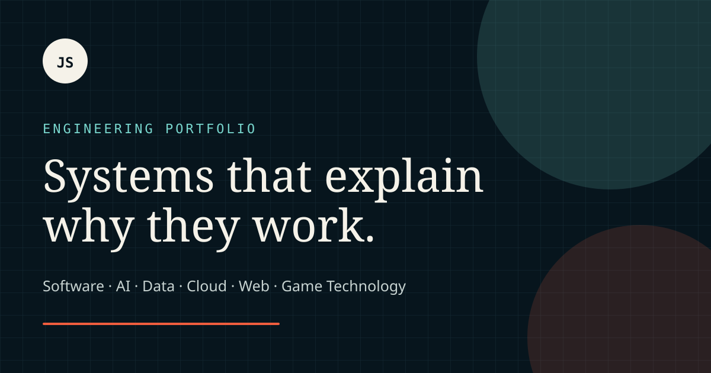

# Portfolio Case Study Site

[](https://github.com/JasonStys/portfolio-case-study-site/actions/workflows/ci.yml)
[](https://github.com/JasonStys/portfolio-case-study-site/actions/workflows/codeql.yml)

An evidence-first engineering portfolio that helps employers evaluate the design judgment behind the code—not just scan a repository list.

**Live site:** [jasonstys.github.io/portfolio-case-study-site](https://jasonstys.github.io/portfolio-case-study-site/)



## Offline Windows application

The native **1.1.0 candidate** packages this same Astro site for offline browsing,
search and evidence inspection. It preserves the existing website and GitHub Pages
hosting. Public HTTPS anchors require an explicit Open/Cancel confirmation; the
app does not discover or launch other projects. See the [native usage, build and
validation guide](docs/native-application.md) for the portable package contract,
profile ownership and current acceptance limits. Publication and installation are
separate from source validation.

## Why this exists

A broad GitHub profile can make strong work harder to evaluate. This site creates one consistent navigation layer across software engineering, full-stack systems, AI/ML, analytics, cloud infrastructure, cybersecurity, DevOps, accessible web development, firmware, and game technology.

Six featured projects use the same employer-friendly narrative:

> problem → constraints → design → verification → measured result → limitations

The complete **67-repository catalog** remains searchable by role, language, domain, maturity, and free text. Every project has a static detail page explaining its practical improvements, rationale, verification links, and limits. Six broad featured cases lead; nine reference cases include four space-systems studies. The [space & energy collection](https://jasonstys.github.io/portfolio-case-study-site/space-systems/) includes all **14 completed space-related projects**. The [drone safety collection](https://jasonstys.github.io/portfolio-case-study-site/drone-systems/) includes all **seven drone projects**, with four evidence-led starting points.

## Security and documentation review — 2026-11-10

The [documentation collection](https://jasonstys.github.io/portfolio-case-study-site/documentation/)
provides a reviewed Word guide for every one of the **67 projects**, with separate
validation reviews and Excel evidence for **24 larger projects**: **91 Word documents
and 24 workbooks**. Each project page identifies its immutable files, full SHA-256
values, documented source and dated validation scope. The workbooks contain genuine
filterable Tables, workflow observations and test-source inventories; inventories
are distinct from executed test results.

Seven additional repositories now run CodeQL: Code Flow Studio, Applicant Evidence
Studio, Personal Image Model Studio, Industrial Edge Digital Twin, Firmware Release
Recovery Lab, Versioned Product Knowledge Portal and Engineering Documentation
Foundry. Reviewed corrections include bounded descriptor reads, ambiguous regular
expressions, release-workflow trust and cancellation-safe native account shutdown.
The [security and documentation review](docs/reports/security-documentation-2026-11-10.md)
links the source, validation and practical limits. The [updated project pages](https://jasonstys.github.io/portfolio-case-study-site/updates/)
explain each project's changes and rationale.

Zero open alerts is different from zero raw findings. Applicant Evidence Studio
and Image Studio retain **two and 29 individually reviewed false positives**,
respectively, with their trust-boundary reasoning preserved. A scan complements
runtime, privacy, dependency, compiler and native-package acceptance. Office
editions, later integration commits and released app bytes retain separate identities.

The [Lighthouse sampling policy](docs/reports/lighthouse-sampling-2026-11-10.md)
uses five fixed fresh-browser runs and median timing values at the existing
thresholds, retaining every sample, observed maximum and exceedance. Accessibility,
best-practices and SEO scores use the minimum; layout shift uses the maximum.
This represents a typical measured load, rather than a worst-case or percentile
guarantee. Earlier three-run results retain their original interpretation.

## Practical workflow upgrades — 2026-11-09

This review improved all **66 domain repositories** in the catalog, then updated
this portfolio hub. The [project updates](https://jasonstys.github.io/portfolio-case-study-site/updates/)
explain each change and why it matters. Examples include unit-aware business search
and authorized export bundles, private evidence comparison, reproducible source
inspection, coherent support snapshots, contingency planning, and coverage-aware
security review. Workflows preserve unknown, incomplete, stale, and conflicting
evidence rather than replacing it with reassuring defaults.

Each domain detail page links its reviewed pull request, immutable merged source,
committed validation report, and successful push workflows at that exact source.
All **130 required domain push workflows** were checked after the changes merged.
These are historical commit-specific results, not continuous certification or a
promise that every future input or external dependency will succeed. The hub's
own CI and Pages deployment are checked separately.

The [download index](https://jasonstys.github.io/portfolio-case-study-site/downloads/) now identifies all **20 existing downloadable projects** and their **62 actual payloads**, with full SHA-256 values, exact application source, runtime requirements and successful native release checks. All **14 space/energy apps** now have refreshed **1.1.0** portable releases; the separately authenticated delivery example is **1.1.0**. The five previously refreshed applications retain their reviewed public bytes. Applicant Evidence Studio additionally verifies its existing download through the real encrypted UI on three operating systems, with verifier source shown separately from application source.

Windows ZIP and POSIX tar.gz bundles preserve the native runtime layout; these are portable applications rather than newly invented installers. Drone Operations supplies a Windows installer only. Secure Delivery supplies a Python zipapp and separate trusted manager source. Other projects retain their documented source, service, library or PWA distribution. Existing source quality and coverage gates remain intact. See the [release review](docs/reports/download-refresh-2026-11-09.md) for changes, rationale, limits and per-project evidence.

## Code Flow Studio 0.4.3: preserve the program's actual result

The leading case highlights [Code Flow Studio v0.4.3](https://github.com/JasonStys/code-flow-studio/releases/tag/v0.4.3) and a practical C# coverage correction. Coverlet collapses a nonzero program return into its own failure status; the new isolated bridge records the actual target exit separately from the collector. Approved returns **0, 1, 2, 7 and 255**, plus malformed input returning 2, now have measured coverage. Real argument rejection, a post-target report-write failure and timeout remain blocked. Source-bound diagnostics, missed-line inspection, unused-code candidates and matching-draft navigation remain part of the twelve-adapter workbench.

The [released source](https://github.com/JasonStys/code-flow-studio/tree/1d0b19ed589947ae45e93555d97331c95cad26cc) passed **419 tests plus 28 subtests**, with **85.01% controller/training coverage** against the unchanged 80% floor. Both hosted 70-scenario compiler lanes passed, including twelve-language failure controls and encrypted private-report replay. All eight source/release/tag workflow runs and 24 jobs passed, including native package journeys on Windows, Linux and macOS; the installed Windows app also passed a separate disposable-account journey. The release gate now requires compiler acceptance for the exact source before preparing or verifying a release.

The [updated case study](https://jasonstys.github.io/portfolio-case-study-site/case-studies/code-flow-studio/) links the protocol, real failure controls, current downloads/checksums and dated historical evidence. Measured instrumentation does not mean 100% source coverage or proven correctness. The same-UID evidence bindings are consistency checks, not hostile-target attestation. Packages are unsigned; local compilation requires the matching `code-flow-worker:0.4.3` image, with no host fallback or automatic Docker changes.

## Space & energy systems: where to start

These are civilian educational projects relevant to space-sector, government and contractor engineering interests—not claims of military employment, clearance, flight qualification or agency endorsement. The existing six broad portfolio highlights remain unchanged; the new collection gives specialist reviewers a direct reading path.

| Highlight                 | What to inspect                                                                                   | Source / detailed case                                                                                                                                                                                 |
| ------------------------- | ------------------------------------------------------------------------------------------------- | ------------------------------------------------------------------------------------------------------------------------------------------------------------------------------------------------------ |
| Flight-software recovery  | C++ executive, watchdog deadlines, checkpoint decoding, independent replay and sanitizers         | [Repository](https://github.com/JasonStys/spacecraft-flight-software-testbed) · [Case study](https://jasonstys.github.io/portfolio-case-study-site/case-studies/spacecraft-flight-software-testbed/)   |
| Explainable telemetry     | Frozen training, causal scoring, held-out comparison, false alarms and missing data               | [Repository](https://github.com/JasonStys/spacecraft-telemetry-anomaly-studio) · [Case study](https://jasonstys.github.io/portfolio-case-study-site/case-studies/spacecraft-telemetry-anomaly-studio/) |
| Exact resource allocation | Branch-and-bound, explicit constraints, greedy comparison and independent exhaustive oracle       | [Repository](https://github.com/JasonStys/mission-contact-resource-scheduler) · [Case study](https://jasonstys.github.io/portfolio-case-study-site/case-studies/mission-contact-resource-scheduler/)   |
| Verification evidence     | Revision bindings, newest-attempt rules, fault coverage, actual JUnit adapter and SQL cross-check | [Repository](https://github.com/JasonStys/mission-verification-evidence-kit) · [Case study](https://jasonstys.github.io/portfolio-case-study-site/case-studies/mission-verification-evidence-kit/)     |

The [complete collection](https://jasonstys.github.io/portfolio-case-study-site/space-systems/) also includes spacecraft power/thermal modeling, orbital safety, CCSDS parsing, delay-tolerant networking, Earth observation, clock integrity, microgrid resilience, sensor calibration, space weather and reactor-system education. All 14 are individually listed in the ordered summary below and searchable with the **Space systems** domain facet. Selection reflects integration depth, independent checks and clear failure evidence—not stars or an arbitrary seniority score.

Most scenarios are synthetic; attributed public Sentinel-2 observations and frozen NOAA weather records are distinguished in their repositories. No operational targeting, live reactor connection or real mission control is supplied. Release downloads are unsigned platform-specific desktop apps; hashes are not publisher signatures. Follow each repository's limitations and OS security policies.

## Drone safety & assurance: where to start

The seven new repositories demonstrate simulator integration, fault injection,
privacy engineering, independent oracles and revision-bound human review. Start
with these four; the complete collection also covers synthetic first-response
resource allocation, uncertainty-aware airspace analysis and OPA/Rego policy checks.

| Highlight                                                                                | Inspectable engineering evidence                                                                                   |
| ---------------------------------------------------------------------------------------- | ------------------------------------------------------------------------------------------------------------------ |
| [Operations console](https://github.com/JasonStys/drone-operations-console)              | Mission-revision approvals, idempotent commands, actual PX4 SIH and native MAVSDK simulator acceptance             |
| [SITL assurance](https://github.com/JasonStys/mavlink-sitl-assurance-lab)                | Two pinned PX4 versions, bounded C++ fault relay, independently checked blackout and acknowledgement-loss recovery |
| [Video privacy](https://github.com/JasonStys/drone-video-privacy-studio)                 | Per-frame solid masking, fresh video-only encoding, decoded pixel verification and independent export approval     |
| [Maintenance readiness](https://github.com/JasonStys/drone-maintenance-readiness-studio) | Serialized counters across component swaps, exactly-once usage and full-input immutable readiness assessments      |

These are educational applications, not real aircraft control, emergency dispatch,
live air-traffic services or flight authorization. Synthetic thresholds are not
certified maintenance standards. Policy checks do not grant legal permission;
masking is not automatic person recognition or guaranteed anonymity. Each repository
documents its own actual acceptance evidence and limitations.

## Portfolio maintenance — 2026-10-22

Dependency updates are reviewed as combined candidates so overlapping proposals do
not undo existing fixes. The maintenance review coordinates matching CodeQL actions,
matching React/ReactDOM versions, reproducible build locks and current security
audit results. Each repository's Actions links show commit-specific results, not a
guarantee that every future revision or external service will succeed. Private run
backups and account data are never included in this public site.

## Ordered portfolio

Business Knowledge Workbench **v1.4.0** extends owner-controlled standardization
with numeric range search over canonical table fields and units. Range conditions
must match the same cell; unqualified values never acquire guessed units. Authorized
bounded ZIP bundles contain saved standards, records, and a SHA-256 manifest.
Scientific-notation normalization has an independent regression. See the
[updated case study](https://jasonstys.github.io/portfolio-case-study-site/case-studies/business-knowledge-workbench/)
and [published release](https://github.com/JasonStys/business-knowledge-workbench/releases/tag/v1.4.0).
It remains the #2 featured project. The private edition is local and owner-only;
shared-team hosting and universal OCR are outside its supported contract.

Created by [Jason Stys](https://github.com/JasonStys) · [Professional contact](https://www.linkedin.com/in/jason-stys-31b30b351/).

This is a reviewed presentation order, not a numeric skill rating. Broad integrated systems lead, followed by specialized systems and defensive assurance labs. Integration depth, reproducible evidence, and role breadth matter more than repository size or popularity. Lower placement does not mean lower quality. The portfolio hub is linked prominently above but is last here because it organizes the engineering work.

GitHub supports six ordered profile pins, but not a custom ordering of every repository in its Repositories tab. The first six below are the selected profile pins and starred highlights; this README and [project catalog](https://jasonstys.github.io/portfolio-case-study-site/projects/) provide the complete curated order. Search filtering preserves that order.

| Order | Repository                                                                                                | Demonstrated outcome                                                                                                                                              |
| ----- | --------------------------------------------------------------------------------------------------------- | ----------------------------------------------------------------------------------------------------------------------------------------------------------------- |
| 1     | [code-flow-studio](https://github.com/JasonStys/code-flow-studio)                                         | Inspect source-bound diagnostics and unused-code candidates; measure C# coverage for approved nonzero exits with separate target and Coverlet collector evidence. |
| 2     | [business-knowledge-workbench](https://github.com/JasonStys/business-knowledge-workbench)                 | Standardize documents and units, search numeric ranges and export authorized record bundles.                                                                      |
| 3     | [personal-image-model-studio](https://github.com/JasonStys/personal-image-model-studio)                   | Review captions, declared provenance and bounded split similarities before local model training.                                                                  |
| 4     | [forge2d-engine](https://github.com/JasonStys/forge2d-engine)                                             | Build deterministic 2D games with collision layers, scene migration and overlap inspection.                                                                       |
| 5     | [secure-delivery-pipeline-lab](https://github.com/JasonStys/secure-delivery-pipeline-lab)                 | Review authenticated release changes, preserve deployment receipts and verify rollback trust.                                                                     |
| 6     | [applicant-evidence-studio](https://github.com/JasonStys/applicant-evidence-studio)                       | Compare authorized applicant evidence by criterion, with citations, unknowns and private exports.                                                                 |
| 7     | [spacecraft-flight-software-testbed](https://github.com/JasonStys/spacecraft-flight-software-testbed)     | Simulate spacecraft software faults and compare onboard transitions with downlinked evidence.                                                                     |
| 8     | [spacecraft-telemetry-anomaly-studio](https://github.com/JasonStys/spacecraft-telemetry-anomaly-studio)   | Investigate telemetry alert episodes with recovery, data gaps, boundary limits and human review.                                                                  |
| 9     | [mission-contact-resource-scheduler](https://github.com/JasonStys/mission-contact-resource-scheduler)     | Replan bounded ground-station contacts during outages and inspect changed resource allocations.                                                                   |
| 10    | [spacecraft-power-thermal-lab](https://github.com/JasonStys/spacecraft-power-thermal-lab)                 | Simulate spacecraft power and heat, tracing unmet loads and interrupted-service recovery.                                                                         |
| 11    | [mission-verification-evidence-kit](https://github.com/JasonStys/mission-verification-evidence-kit)       | Trace mission requirements to evidence and prioritize stale or missing revalidation work.                                                                         |
| 12    | [orbital-safety-workbench](https://github.com/JasonStys/orbital-safety-workbench)                         | Explore civilian close-approach simulations with threshold windows and explicit sampling limits.                                                                  |
| 13    | [ccsds-telemetry-integrity-lab](https://github.com/JasonStys/ccsds-telemetry-integrity-lab)               | Inspect packet continuity by APID, with provisional gaps, late recovery and ambiguous sequence history.                                                           |
| 14    | [delay-tolerant-mission-network-lab](https://github.com/JasonStys/delay-tolerant-mission-network-lab)     | Replay delayed message delivery and explain queue, hop, expiry and contact bottlenecks.                                                                           |
| 15    | [earth-observation-change-studio](https://github.com/JasonStys/earth-observation-change-studio)           | Review mapped image changes with crop-edge, excluded-area and unknown-context overlays.                                                                           |
| 16    | [mission-clock-integrity-lab](https://github.com/JasonStys/mission-clock-integrity-lab)                   | Reconstruct supported event order from clock uncertainty without forcing ambiguous observations.                                                                  |
| 17    | [resilient-energy-microgrid-lab](https://github.com/JasonStys/resilient-energy-microgrid-lab)             | Compare feeder-loss simulations and critical-load shortfalls using consistent energy accounting.                                                                  |
| 18    | [scientific-sensor-calibration-lab](https://github.com/JasonStys/scientific-sensor-calibration-lab)       | Fit sensor calibrations and explain covariance contributions, cross terms and uncertainty limits.                                                                 |
| 19    | [space-weather-impact-observatory](https://github.com/JasonStys/space-weather-impact-observatory)         | Compare space-weather evidence by lead time and observation window while retaining coverage gaps.                                                                 |
| 20    | [reactor-systems-simulator](https://github.com/JasonStys/reactor-systems-simulator)                       | Compare bounded educational thermal scenarios, forcing changes and sampled peak responses.                                                                        |
| 21    | [drone-operations-console](https://github.com/JasonStys/drone-operations-console)                         | Edit and replay civilian drone scenes with obstacle checks, saved routes and timeline scrubbing.                                                                  |
| 22    | [mavlink-sitl-assurance-lab](https://github.com/JasonStys/mavlink-sitl-assurance-lab)                     | Test simulated MAVLink faults and inspect delay, drop and ambiguous packet-correlation evidence.                                                                  |
| 23    | [first-response-drone-coordinator](https://github.com/JasonStys/first-response-drone-coordinator)         | Compare civilian response plans under aircraft or operator loss with revision-bound human review.                                                                 |
| 24    | [drone-video-privacy-studio](https://github.com/JasonStys/drone-video-privacy-studio)                     | Redact video and review manual keyframes with conservative privacy envelopes and controlled exports.                                                              |
| 25    | [drone-maintenance-readiness-studio](https://github.com/JasonStys/drone-maintenance-readiness-studio)     | Track component life and compare draft maintenance standards before changing approved records.                                                                    |
| 26    | [drone-airspace-awareness-lab](https://github.com/JasonStys/drone-airspace-awareness-lab)                 | Inspect synthetic traffic overlaps with track freshness, altitude-reference limits and coverage gaps.                                                             |
| 27    | [drone-flight-policy-workbench](https://github.com/JasonStys/drone-flight-policy-workbench)               | Compare active and draft drone policies against identical evidence without authorizing flight.                                                                    |
| 28    | [cloud-job-orchestrator](https://github.com/JasonStys/cloud-job-orchestrator)                             | Diagnose job DAGs, retries and lease state through coherent snapshots and a PostgreSQL workflow.                                                                  |
| 29    | [integration-operations-console](https://github.com/JasonStys/integration-operations-console)             | Search integration jobs, inspect captured audit history and download exact support reviews.                                                                       |
| 30    | [ml-model-lifecycle-observatory](https://github.com/JasonStys/ml-model-lifecycle-observatory)             | Review authenticated model release dossiers with recorded quality gates, history and drift context.                                                               |
| 31    | [player-telemetry-analytics-platform](https://github.com/JasonStys/player-telemetry-analytics-platform)   | Analyze player retention with receipt-time cutoffs and explicit mature versus incomplete cohorts.                                                                 |
| 32    | [industrial-edge-digital-twin](https://github.com/JasonStys/industrial-edge-digital-twin)                 | Replay simulated industrial signals, faults and alarms with synchronized trends and read-only review.                                                             |
| 33    | [accessible-design-system-lab](https://github.com/JasonStys/accessible-design-system-lab)                 | Use accessible React tables with stable sorting, paging, preserved focus and clear status feedback.                                                               |
| 34    | [edge-vision-deployment-benchmark](https://github.com/JasonStys/edge-vision-deployment-benchmark)         | Compare inference runtimes across shared image conditions using per-class quality and calibration gates.                                                          |
| 35    | [secure-service-desk](https://github.com/JasonStys/secure-service-desk)                                   | Manage tenant ticket ownership with version checks, atomic audit history and owner/SLA work queues.                                                               |
| 36    | [offline-first-field-app](https://github.com/JasonStys/offline-first-field-app)                           | Resolve offline sync conflicts with explicit field choices and protection against stale overwrites.                                                               |
| 37    | [mips-pipeline-workbench](https://github.com/JasonStys/mips-pipeline-workbench)                           | Inspect imported MIPS pipeline traces, navigate hazards and measure performance beyond display limits.                                                            |
| 38    | [firmware-release-recovery-lab](https://github.com/JasonStys/firmware-release-recovery-lab)               | Rehearse simulated fleet updates with compatibility checks, trial outcomes and rollback safeguards.                                                               |
| 39    | [ot-security-monitor-lab](https://github.com/JasonStys/ot-security-monitor-lab)                           | Audit passive Modbus read coverage by asset, function and address while keeping capture gaps visible.                                                             |
| 40    | [industrial-memory-protocol-workbench](https://github.com/JasonStys/industrial-memory-protocol-workbench) | Reassemble fragmented binary streams with bounded buffering and exact corruption and EOF offsets.                                                                 |
| 41    | [detection-engineering-lab](https://github.com/JasonStys/detection-engineering-lab)                       | Compare detection rules on the same events and preserve alert evidence with reasoned analyst review.                                                              |
| 42    | [sre-observability-workbench](https://github.com/JasonStys/sre-observability-workbench)                   | Compare service and user-journey SLOs over matched windows, exposing quality gaps and weakened targets.                                                           |
| 43    | [gitops-platform-lab](https://github.com/JasonStys/gitops-platform-lab)                                   | Verify GitOps convergence across desired and applied revisions, dependencies and evidence freshness.                                                              |
| 44    | [container-runtime-security-lab](https://github.com/JasonStys/container-runtime-security-lab)             | Triage runtime alert episodes with coverage limits and human dispositions that preserve original evidence.                                                        |
| 45    | [zero-trust-segmentation-lab](https://github.com/JasonStys/zero-trust-segmentation-lab)                   | Review policy and exception expiry against owner-defined access continuity requirements.                                                                          |
| 46    | [application-security-regression-lab](https://github.com/JasonStys/application-security-regression-lab)   | Compare saved HTTP security regressions while exposing changed assertions and unexecuted cases.                                                                   |
| 47    | [cloud-identity-access-lab](https://github.com/JasonStys/cloud-identity-access-lab)                       | Compare signed access-policy decisions across MFA, expiry and authenticated registry contexts.                                                                    |
| 48    | [ai-security-evaluation-lab](https://github.com/JasonStys/ai-security-evaluation-lab)                     | Replay reviewed AI security cases and separate unsafe allowances from unavailable or untested behavior.                                                           |
| 49    | [infrastructure-policy-lab](https://github.com/JasonStys/infrastructure-policy-lab)                       | Review infrastructure drift and replacements with plan-bound receipts that preserve policy gates.                                                                 |
| 50    | [disaster-recovery-drill-lab](https://github.com/JasonStys/disaster-recovery-drill-lab)                   | Compare measured recovery candidates, data loss and retention choices without deleting backups.                                                                   |
| 51    | [disconnected-release-kit](https://github.com/JasonStys/disconnected-release-kit)                         | Review authenticated offline release contents and inventories with state-bound, non-executing receipts.                                                           |
| 52    | [incident-response-evidence-kit](https://github.com/JasonStys/incident-response-evidence-kit)             | Bookmark verified incident evidence by digest and line, then export minimized, traceable handoffs.                                                                |
| 53    | [secret-rotation-reliability-lab](https://github.com/JasonStys/secret-rotation-reliability-lab)           | Review secret rotation by generation, consumer acknowledgement, drain state and expiry.                                                                           |
| 54    | [vulnerability-prioritization-console](https://github.com/JasonStys/vulnerability-prioritization-console) | Compare vulnerability evidence and owner deadlines without treating absent findings as proven fixes.                                                              |
| 55    | [windows-identity-audit-lab](https://github.com/JasonStys/windows-identity-audit-lab)                     | Review nested identity exposure, source completeness and owner recertification deadlines.                                                                         |
| 56    | [network-defense-analysis-lab](https://github.com/JasonStys/network-defense-analysis-lab)                 | Filter captured network events by UTC, protocol and severity with snapshot paging and visible data gaps.                                                          |
| 57    | [memory-safety-analysis-lab](https://github.com/JasonStys/memory-safety-analysis-lab)                     | Minimize reproducible parser disagreements under shared budgets, preserving unstable outcomes.                                                                    |
| 58    | [unity-tactical-ai-sandbox](https://github.com/JasonStys/unity-tactical-ai-sandbox)                       | Inspect deterministic game replays with timeline scrubbing, terrain and independent bot diagnostics.                                                              |
| 59    | [mqtt-lifecycle-reliability-lab](https://github.com/JasonStys/mqtt-lifecycle-reliability-lab)             | Recover bounded MQTT outboxes with original TTLs, explicit losses and retained failed publishes.                                                                  |
| 60    | [offline-incident-timeline-pwa](https://github.com/JasonStys/offline-incident-timeline-pwa)               | Investigate local incident logs with UTC filters, shareable query state and offline restoration.                                                                  |
| 61    | [documentation-quality-gate](https://github.com/JasonStys/documentation-quality-gate)                     | Track documentation debt by exact location and refresh baselines without losing unexamined findings.                                                              |
| 62    | [versioned-product-knowledge-portal](https://github.com/JasonStys/versioned-product-knowledge-portal)     | Compare documentation editions beside canonical sources, warnings and missing counterparts.                                                                       |
| 63    | [engineering-documentation-foundry](https://github.com/JasonStys/engineering-documentation-foundry)       | Publish accessible documentation and compare source-cited revisions, including safety-warning changes.                                                            |
| 64    | [node-red-resilient-metadata](https://github.com/JasonStys/node-red-resilient-metadata)                   | Recover metadata lookups with bounded Retry-After delays, rate-limit spacing and cancellation.                                                                    |
| 65    | [host-hardening-assurance-lab](https://github.com/JasonStys/host-hardening-assurance-lab)                 | Review host-hardening evidence against expected inventory, policies and owner refresh queues.                                                                     |
| 66    | [rmf-evidence-workbench](https://github.com/JasonStys/rmf-evidence-workbench)                             | Maintain scoped OSCAL evidence with owner calendars, freshness checks and risk/milestone queues.                                                                  |
| 67    | [portfolio-case-study-site](https://github.com/JasonStys/portfolio-case-study-site)                       | Explore ranked projects through searchable case studies, technical rationale and validation links.                                                                |

Use the Role/Domain filters for security, DevOps, cloud, AI/ML, data, frontend, systems, and game-engine paths. Government-oriented governance examples use fictional evidence and do not claim authorization or certification. Local account apps remain local-first, with explicit unsigned-package and trusted-host limits; they are not advertised as public production services.

## Sixty-second quick start

Requirements: Node.js 24 and npm 11 or newer.

```bash
git clone https://github.com/JasonStys/portfolio-case-study-site.git
cd portfolio-case-study-site
npm ci
npm run dev
```

Open `http://localhost:4321/portfolio-case-study-site/`.

For a release-equivalent local build:

```bash
npm run verify
npm run test:e2e
npm run lighthouse
```

## Major features

### Evidence-led overview

The home page explains how to evaluate the portfolio, shows derived breadth metrics, and presents six role-spanning case studies rather than a decorative résumé layout.

### Schema-validated case studies

Astro's content collection validates titles, repository URLs, summaries, languages, evidence lists, and featured order at build time. A malformed case cannot deploy.

### Reproducible repository metadata

`src/data/github-repositories.json` is a reviewed cache of public GitHub facts. Production builds never depend on GitHub availability. `npm run metadata:refresh` updates the cache intentionally; `npm run metadata:check` enforces freshness without network access.

### Precomputed search

`search-index.json` is generated during the static build. The browser downloads a versioned inverted index and performs deterministic intersections for keywords and exact facets. All project cards remain readable when JavaScript is unavailable.

### Accessible, resilient presentation

- Semantic landmarks, headings, labels, lists, and native controls.
- Skip navigation, visible focus, keyboard workflows, and live result counts.
- Minimum interactive target sizing and responsive single-column flow.
- Reduced-motion and forced-colors accommodations.
- Text alternatives for the architecture diagram and visible data instead of canvas-only charts.

### Discoverability and delivery

- Canonical metadata, Open Graph/Twitter cards, `ProfilePage` and `SoftwareSourceCode` JSON-LD.
- RSS project feed, sitemap, robots policy, manifest, favicon, and custom 404 page.
- GitHub Pages deployment only after quality, browser, and Lighthouse jobs pass.
- Exact dependency lock, reviewed install scripts, Dependabot, dependency review, CodeQL, and SHA-pinned Actions.

## Architecture

```text
Reviewed Markdown ─┐
                   ├─> schema validation ─> Astro static build ─> GitHub Pages
GitHub JSON cache ─┘                         ├─ HTML case studies
                                            ├─ search-index.json
                                            ├─ RSS + sitemap
                                            └─ versioned assets
```

The public site has no server, database, authentication, tracking script, or runtime GitHub API dependency. See [Architecture](docs/ARCHITECTURE.md) and [ADR-0001](docs/adrs/0001-static-astro.md) for alternatives and tradeoffs.

## Search behavior and complexity

Let `n` be projects, `t` unique indexed tokens, `q` query tokens, and `m` the current candidate set.

- Index construction: expected `O(total indexed tokens)` time and `O(total postings)` space.
- Query tokenization: `O(query length)`.
- Ordered posting intersections: `O(q × n)` in this small, deterministic implementation.
- Exact facets: one additional ordered intersection per selected facet.

The catalog is intentionally small, so predictable code is more valuable than compression or ranked retrieval. A synthetic 10,000-project benchmark protects the chosen implementation from accidental quadratic work inside index construction. See [Complexity](docs/COMPLEXITY.md) and [Performance report](docs/reports/PERFORMANCE.md).

## Testing and validation

| Layer            | Evidence                                                                           |
| ---------------- | ---------------------------------------------------------------------------------- |
| Content contract | Astro/Zod collection schema and catalog/cache validation                           |
| Unit             | Tokenization, postings, intersections, facets, URLs, XML, cache failure cases      |
| Browser          | Recruiter journey, filtering, URL restoration, keyboard flow, mobile layout        |
| Accessibility    | axe WCAG A/AA rules plus manual-contract assertions                                |
| Performance      | 10,000-project search benchmark, asset budgets, five-run Lighthouse timing medians |
| Build            | Required routes, base-path links, discovery artifacts, metadata, static output     |
| Security         | npm audit, dependency review, CodeQL, header/action/secret/content validators      |
| Deployment       | Pages artifact is published only after all required CI jobs succeed                |

Coverage thresholds are enforced at 92% statements, functions, and lines and 88% branches for the core TypeScript library. Exact release results live in [Test summary](docs/reports/TEST_SUMMARY.md) and [Site quality](docs/reports/SITE_QUALITY.md).

## Repository structure

| Path              | Purpose                                                                          |
| ----------------- | -------------------------------------------------------------------------------- |
| `.github/`        | Least-privilege CI, Pages, CodeQL, dependency review, and update policy.         |
| `src/components/` | Shared Astro layout, navigation, project, metric, and diagram components.        |
| `src/content/`    | Six featured and nine reference Markdown engineering case studies.               |
| `src/data/`       | Public GitHub cache, editorial curation, and canonical priority order.           |
| `src/lib/`        | Catalog validation, inverted search, URLs, XML, and domain types.                |
| `src/pages/`      | Static overview, catalog, case routes, feeds, sitemap, robots, and 404.          |
| `src/scripts/`    | The only browser-delivered TypeScript enhancement: catalog filtering.            |
| `src/styles/`     | Complete responsive visual system and accessibility preference support.          |
| `tests/`          | Unit, browser, accessibility, navigation, and layout checks.                     |
| `scripts/`        | Metadata refresh, benchmarks, validators, indexes, and Lighthouse orchestration. |
| `docs/`           | Architecture, ADR, operations, testing, security, reports, and exact indexes.    |
| `public/`         | Favicon, manifest, and social preview artwork.                                   |

Every authored file is summarized in the generated [File catalog](docs/FILE_CATALOG.md). Every code declaration is mapped to an exact one-based line in [Code index](docs/CODE_INDEX.md).

## Documentation index

- [Architecture](docs/ARCHITECTURE.md)
- [Architecture decision](docs/adrs/0001-static-astro.md)
- [Complexity](docs/COMPLEXITY.md)
- [Content maintenance](docs/CONTENT_GUIDE.md)
- [Testing strategy](docs/TESTING.md)
- [Security model](docs/SECURITY.md)
- [Operations and metadata refresh](docs/OPERATIONS.md)
- [Deployment and rollback checklist](docs/DEPLOYMENT_CHECKLIST.md)
- [Known limitations](docs/LIMITATIONS.md)
- [Research notes](docs/RESEARCH.md)
- [Test summary](docs/reports/TEST_SUMMARY.md)
- [Performance report](docs/reports/PERFORMANCE.md)
- [Site-quality report](docs/reports/SITE_QUALITY.md)
- [Space & energy synchronization evidence](docs/reports/portfolio-sync-2026-10-21.md)
- [Business standardization summary update](docs/reports/business-standards-sync-2026-10-21.md)
- [Code Flow v0.3.0 summary update and portfolio validation](docs/reports/code-flow-sync-2026-10-21.md)
- [Code Flow v0.4.3 release, C# coverage and portfolio validation](docs/reports/code-flow-043-sync-2026-11-10.md)

## Privacy and safety

Only public repository facts and deliberately authored portfolio content are committed. The site contains no visitor analytics, remote fonts, contact form, cookies, credentials, private repository names, customer data, or employer source code. Résumé PDFs are not copied automatically because public release should follow a separate personal-information review.

## Limitations

- GitHub facts are snapshots and can be stale until the explicit refresh command runs.
- Automated accessibility checks do not replace evaluation with assistive-technology users.
- Case studies summarize checked-in evidence but do not claim commercial production usage.
- GitHub Pages provides static hosting; contact, authentication, and dynamic personalization are out of scope.
- The social preview is SVG-first. Some social crawlers may prefer a raster asset in a future custom-domain release.

## License

Source code is available under the [MIT License](LICENSE). Project descriptions and personal profile content remain attributable to Jason Stys.

## Documentation editions

Start with the [organized handbook](docs/handbook.md) for current usage, design, security and test guidance. Reviewed downloadable editions: [project-guide.docx](docs/reports/project-guide.docx).

[Publication identities and source scope](docs/reports/publications.json) · [Documentation validation record](docs/reports/documentation-refresh-2026-11-09.md). Historical results retain their own tested revision and date.
